# SQ80

SQ-80 turns the M-VAVE FM-1 into an Ensoniq SQ-80: three oscillators, a resonant filter, four envelopes and three
LFOs per voice, eight voices, effects, an arpeggiator and a step sequencer. This manual walks through every screen.

## Contents

1. The panel
2. Getting started
3. Playing
4. HOME: the scope and RANDOM
5. Editing a sound
6. Saving a program
7. Effects
8. Arpeggiator
9. Sequencer
10. GLO: settings and the load
11. MIDI and Bluetooth
12. The web pages

---

## 1. The panel

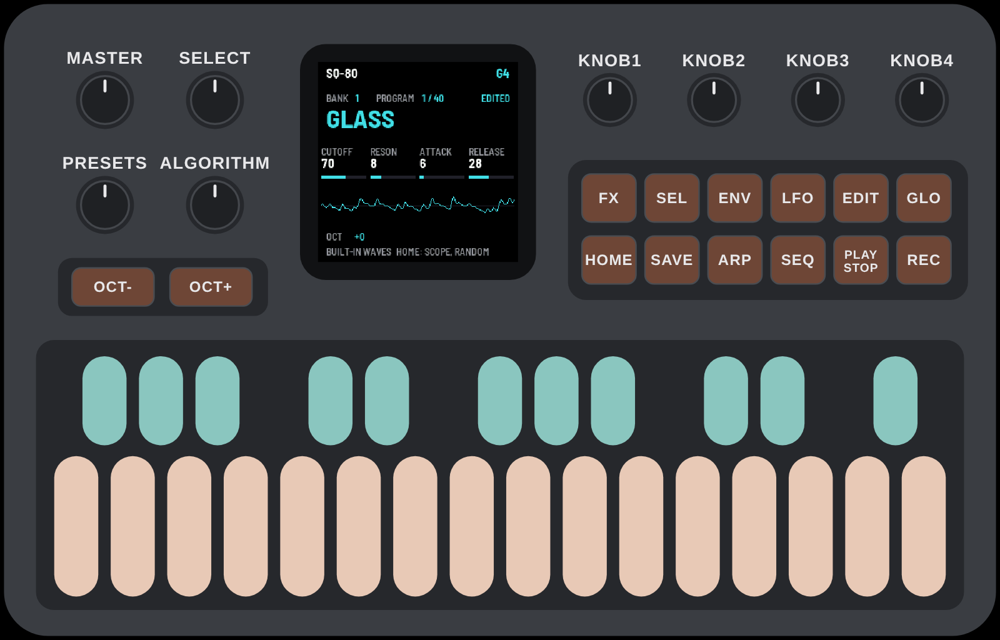

| Control | What it does |
|---|---|
| **PRESETS** | the next or previous program |
| **SELECT** | the next or previous bank (1–8) |
| **ALGORITHM** | the next or previous page of the screen you are on |
| **KNOB 1–4** | the four values shown along the middle of the screen |
| **OCT− / OCT+** | the keyboard's octave |
| **MASTER** | the volume |
| **HOME** | back to playing; on the playing screen, the scope and RANDOM |
| **SEL · ENV · LFO · EDIT** | edit the sound: oscillators, envelopes, LFOs, the rest |
| **FX** | the effects |
| **SAVE** | store the program |
| **ARP** | tap: arpeggiator on / off · hold: its settings |
| **SEQ** | the step sequencer (hold: the keys become steps) |
| **PLAY / REC** | start / stop the sequencer · record into it |
| **GLO** | settings and the audio load |

The keys light softly when idle and fully while you play them.

## 2. Getting started

Install SQ-80 from the **Install** page in Chrome or Edge, with the FM-1 connected by USB. It plays at once with its
own set of 75 waves. If you own an SQ-80's ROMs, the installer can also load your **ROM pack** (the original
waves: make it on the **ROM pack** page) and your **ESQ-1 / SQ-80 banks** (`.syx`), and it remembers them for the
next install.

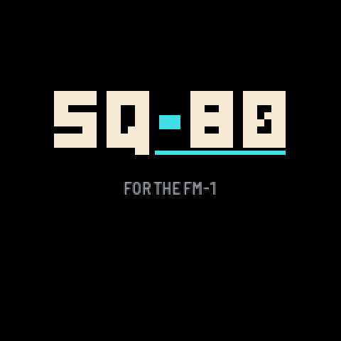

There are eight banks of 40 programs. The installer fills them with SQ-80's own 320 programs (by Leonardo Lopez Chavira), unless you give it banks of your own; the emulator has them too. A place where nothing was stored plays **INIT**, a plain sound to start from.

## 3. Playing

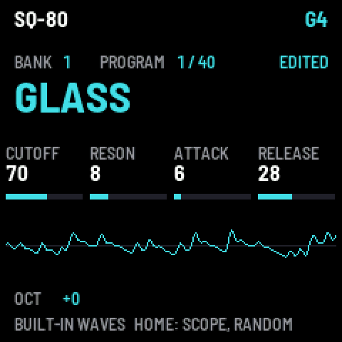

The playing screen shows the **bank** and **program**, the program's **name** (cyan while it has unsaved changes),
and what **KNOB 1–4** do here: **CUTOFF**, **RESONANCE**, **ATTACK** and **RELEASE** of the program. Under them, the
**waveform** of what you hear. At the bottom: the **octave**, where MIDI comes from, and the sequencer when it runs.

Turn **PRESETS** for the next program, **SELECT** for the next bank. The note you play last shows top right.

## 4. HOME: the scope and RANDOM

Press **HOME** on the playing screen to go through three screens:

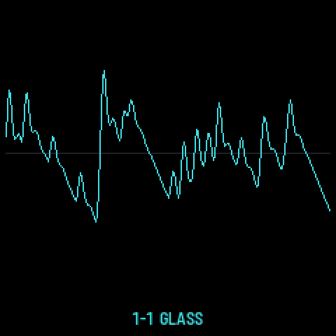
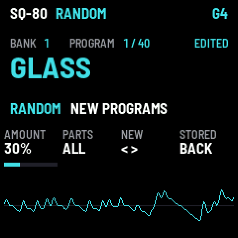

**The scope**: the waveform alone, large, with the bank, program and name at the foot.

**RANDOM** makes new programs from the one playing:

| Knob | |
|---|---|
| **K1 AMOUNT** | how far each value may move (5–100 %; 100 %: anywhere) |
| **K2 PARTS** | what changes: ALL, OSC, FILTER, ENV, LFO, MOD (the modulation) |
| **K3 NEW** | right: a new program · left: the one before (8 kept) |
| **K4 STORED** | back to the program as it is stored |

New programs are named RND001, RND002… and are never silent. Keep one you like with **SAVE**. **HOME** again goes back
to playing.

## 5. Editing a sound

Four buttons open the editor. **ALGORITHM** turns the pages of each; **KNOB 1–4** change the four values shown;
**HOME** goes back to playing (the changes kept, not yet saved).

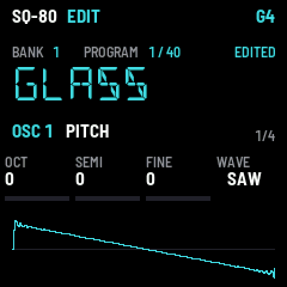
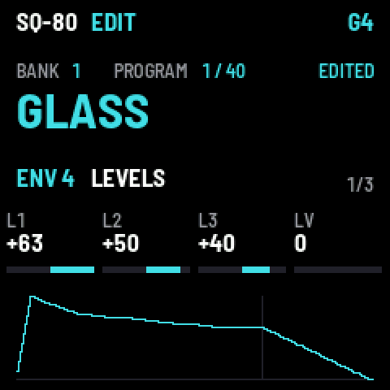
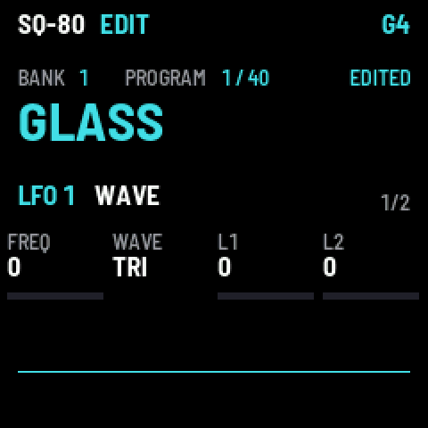
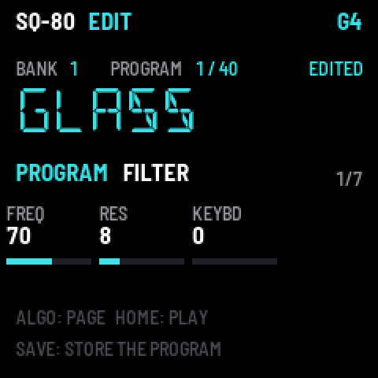

- **SEL** — the three **oscillators** (press again: OSC 1, 2, 3). Pages: PITCH (octave, semitone, fine, **wave**),
  PITCH MOD, DCA (level, output, level mod), DCA MOD 2. The wave is drawn.
- **ENV** — the four **envelopes** (press again: ENV 1–4; **ENV 4 is the volume**). Pages: LEVELS, TIMES, KEY. The
  shape is drawn.
- **LFO** — the three **LFOs**. Pages: WAVE (rate, shape, depths), MORE (delay, mod, humanize, reset).
- **EDIT** — the rest: FILTER (its response drawn: the curve at C4, its cutoff in Hz, and with KEYBD the curves at C2 and C6 dim), FILTER MOD, OUTPUT, MODES (sync, AM, mono, glide), RESTART, and the **name**
  (NAME 1–4, NAME 5–6: one letter per knob).

Every value works as on the SQ-80. On a computer, the **Editor** page shows them all at once.

## 6. Saving a program

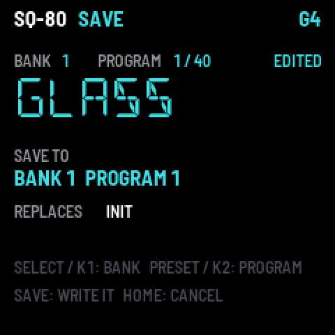

Press **SAVE** from any screen. Choose where with **SELECT** or **K1** (the bank) and **PRESETS** or **K2** (the
program); the screen shows the program you would replace. **SAVE** again stores it; **HOME** cancels.

The bank, program, octave, effects, arpeggiator and sequencer settings keep themselves: a few seconds after a change
they are remembered, with no need to save.

## 7. Effects

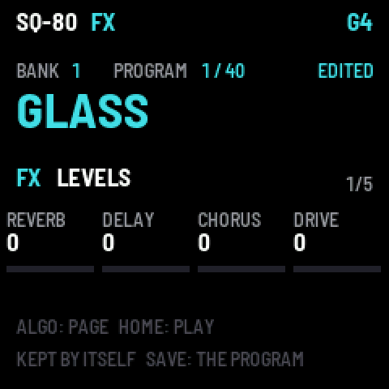
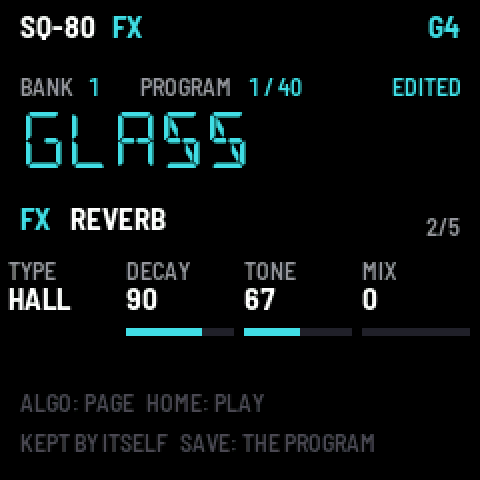

**FX** opens the effects (from FMini-1): the first page sets the levels of **REVERB**, **DELAY**, **CHORUS** and
**DRIVE**; **FX** again or **ALGORITHM** opens each one's page: its **TYPE** and settings.

| Effect | Types |
|---|---|
| Reverb | ROOM, HALL, PLATE, SPRING, CLOUD |
| Delay | ANALOG, DIGITAL, TAPE, P-PONG, MULTI, SLAP, REVERSE, A-SYNC (in time with the tempo) |
| Chorus | STEREO, JUNO, MULTI |
| Drive | SOFT, TUBE |

## 8. Arpeggiator

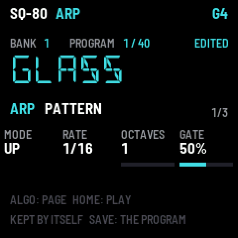

**Tap ARP** to turn it on or off (its light shows it). Hold the keys you want arpeggiated. **Hold ARP** for its pages:

| Page | Knobs |
|---|---|
| PATTERN | **MODE** (UP, DOWN, UP/DN, RANDOM, ORDER, REPEAT, DN/UP, UP+8, CONV, DIVG, PINKY, THUMB, WALK, CHORD) · **RATE** (1/4 … 1/32, triplets) · **OCTAVES** (1–4) · **GATE** |
| FEEL | **SWING** · **HOLD** (the notes go on when you let go) · **ORDER** (low to high, or as played) · **CHANCE** |
| TEMPO | **TEMPO** · **MIDI CLK** (follow a MIDI clock) · ARP on / off |

While the sequencer plays, the arpeggiator follows its beat; while recording, its notes are recorded.

## 9. Sequencer

A pattern of up to 64 steps, each a note or a chord of up to four, a tie, a rest; with accents, slides and
ratchets.

### Entering notes

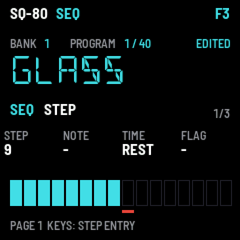

Tap **SEQ**: its first page, **STEP**, is **step entry**. Play a note (or a chord): it goes into the marked step, and
when you let go the mark moves on. **K1** moves the mark, **K2** changes the step's notes, **K3** makes it a NOTE, TIE
or REST, **K4** adds an accent or a slide.

### The keys as steps

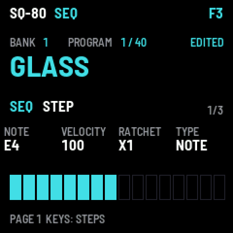

**Hold SEQ** (or tap it again on its page): the **16 white keys are steps 1–16** of the page, lit where they hold
notes; the first four **black keys** (or OCT− / OCT+) choose the page (steps 1–16, 17–32, 33–48, 49–64). Press an
empty step to fill it with the last note you played; press a full one and let go to clear it; hold it and turn
**K1** its note, **K2** its velocity, **K3** its ratchets (×1–×4), **K4** its type.

### Length, timing, playing, recording

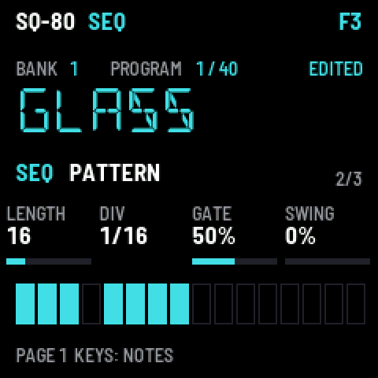
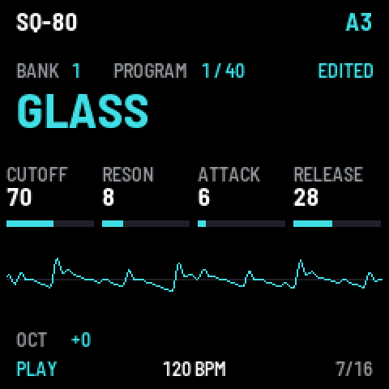

**ALGORITHM** on SEQ: **PATTERN** (LENGTH 1–64, DIV 1/4 … 2 bars, GATE, SWING), then **TEMPO** and **MIDI CLK**.

- **PLAY** starts and stops it. The PLAY light flashes on the beat.
- **REC** while it plays records what you play, as you heard it, layer after layer; held notes become ties.
  **REC** while it is stopped gets ready: your first note starts the loop and records.
- **Hold REC 2 seconds** clears the pattern. **EDIT + OCT−** undoes, **EDIT + OCT+** redoes.

## 10. GLO: settings and the load

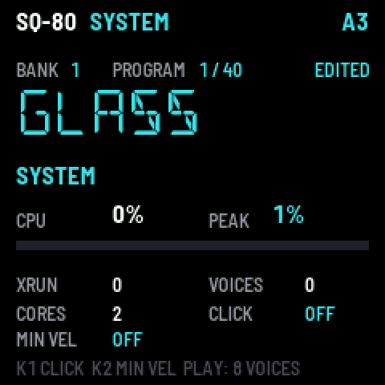

**GLO** shows how hard the FM-1 is working: **CPU** now and its **PEAK**, **XRUN** (under-runs: should stay 0),
voices and cores. **GLO** again sets the peak to 0. **PLAY** here plays all eight voices at once, as a test.

- **K1 CLICK** — a metronome: OFF, REC (while recording), ON (whenever the sequencer plays).
- **K2 MIN VEL** — the softest velocity the keys play (0–127): for an even touch, the rest of your playing spread
  above it.

## 11. MIDI and Bluetooth

SQ-80 plays from MIDI over **USB**, the **MIDI in jack** and **Bluetooth**, on any channel: notes with velocity,
pitch bend, aftertouch, mod wheel, sustain and program changes. A MIDI clock leads the sequencer and the arpeggiator
(MIDI CLK on). The keys send their notes out over USB and Bluetooth.

**Bluetooth** is on from power-on. On a Mac: Audio MIDI Setup → Window → Show MIDI Studio → the Bluetooth button →
**FM-1 XXXX** → Connect. On an iPad: in the music app's own Bluetooth MIDI settings.

## 12. The web pages

| Page | |
|---|---|
| **Install** | installs SQ-80, with your ROM pack and banks if you have them |
| **Load** | loads a ROM pack or banks on their own, or clears banks back to INIT |
| **Librarian** | banks side by side: hear any program with a click, put your own bank together, export it or send it to the FM-1 |
| **Editor** | every value of a program at once, heard as you change it, live on the FM-1; **Randomize** for new ones |
| **Emulator** | SQ-80 in the browser: the same firmware |
| **ROM pack** | makes your ROM pack from your SQ-80's ROM dumps |
| **Wave pack** | makes a wave set from your own sounds |

Chrome or Edge, with the FM-1 connected by USB. Nothing is uploaded: your files stay on your computer.
